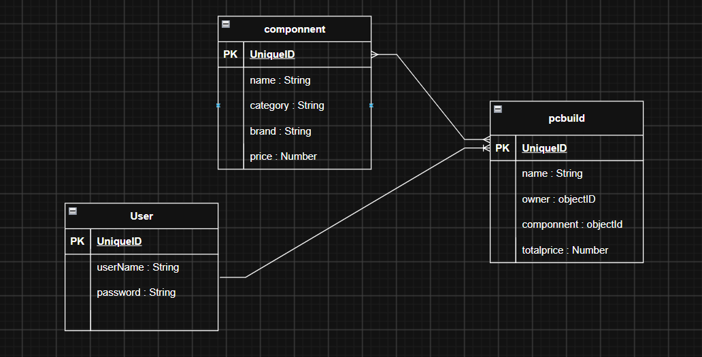

# BuildMyPC — Custom PC Builder

 ## Project Idea

BuildMyPC is a full-stack web application that helps users plan and manage custom desktop PC builds. Registered users can browse available computer components (such as CPUs, GPUs, RAM, motherboards, storage, and power supplies), select parts for a build, view an estimated total price, and save their builds for later. Users can create, view, edit, and delete their own PC builds.
## user stories 
User Stories (8 Total)
1. As a visitor, I want to register an account so that I can create my own PC builds.
2. As a user, I want to log in and log out so that I can securely access my account.
3. As a user, I want to browse available PC components so that I can choose parts for my build.
4. As a user, I want to create a custom PC build so that I can save my selected components.
5. As a user, I want to view the total price of my PC build so that I can manage my budget.
6. As a user, I want to view all my saved PC builds so that I can review them.
7. As a user, I want to edit my PC build so that I can change its components.
8. As a user, I want to delete a PC build so that I can remove unwanted builds.

## Database Design
