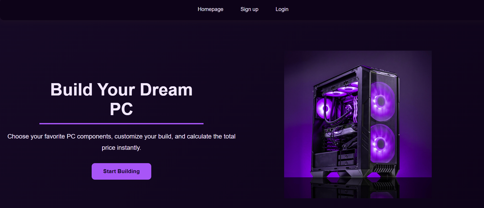
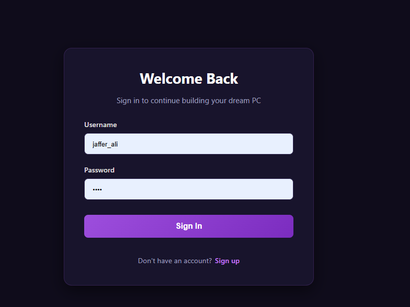
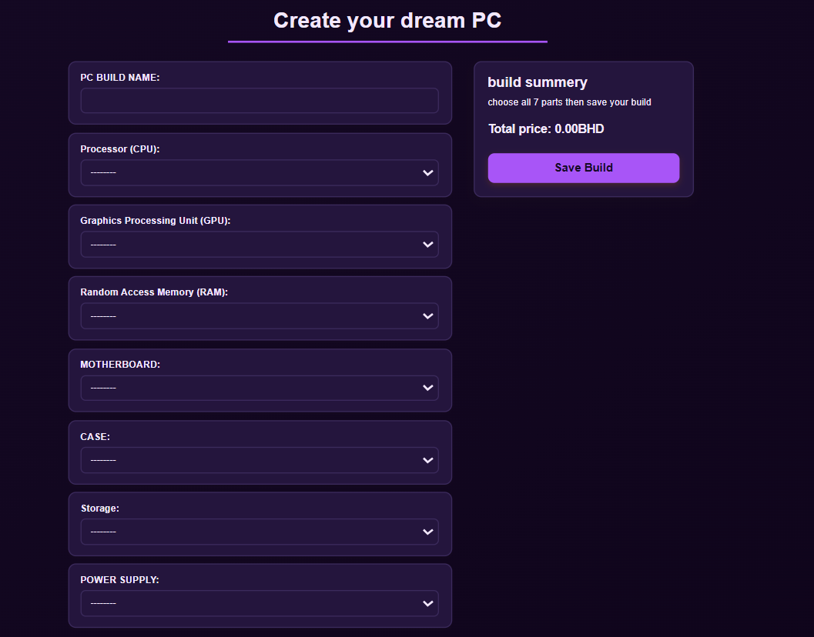
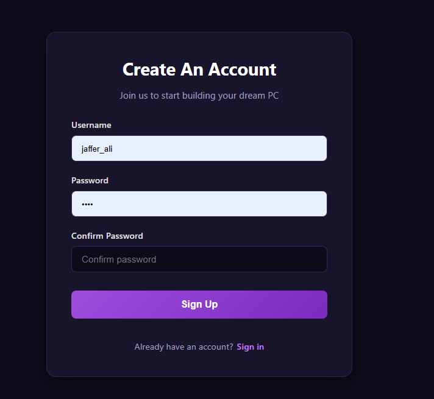
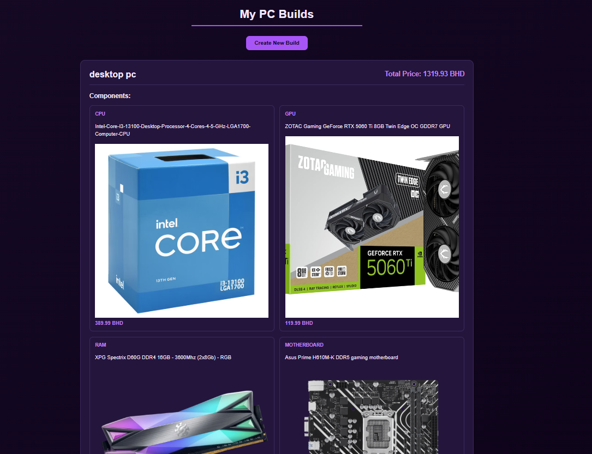
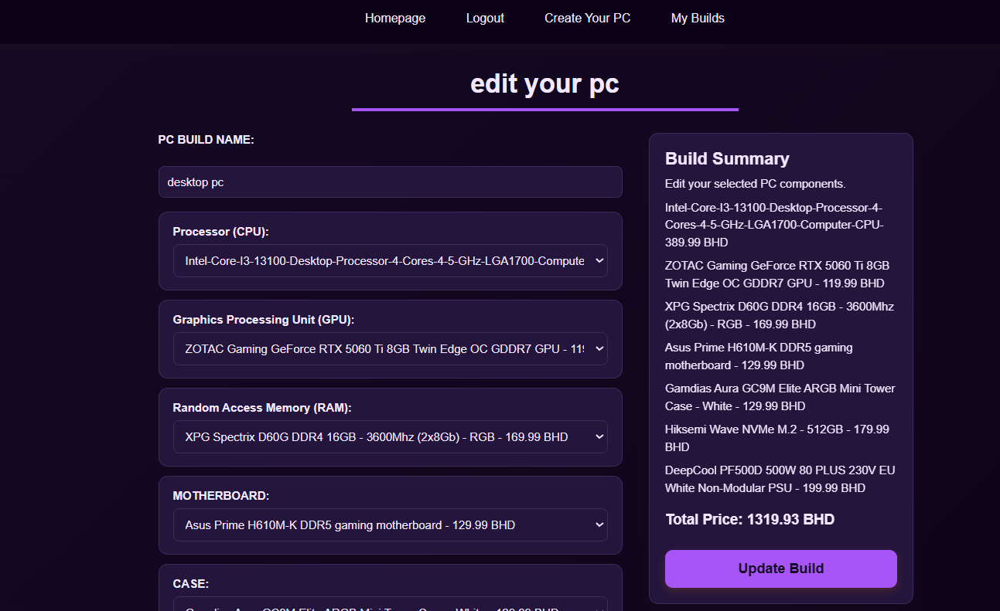
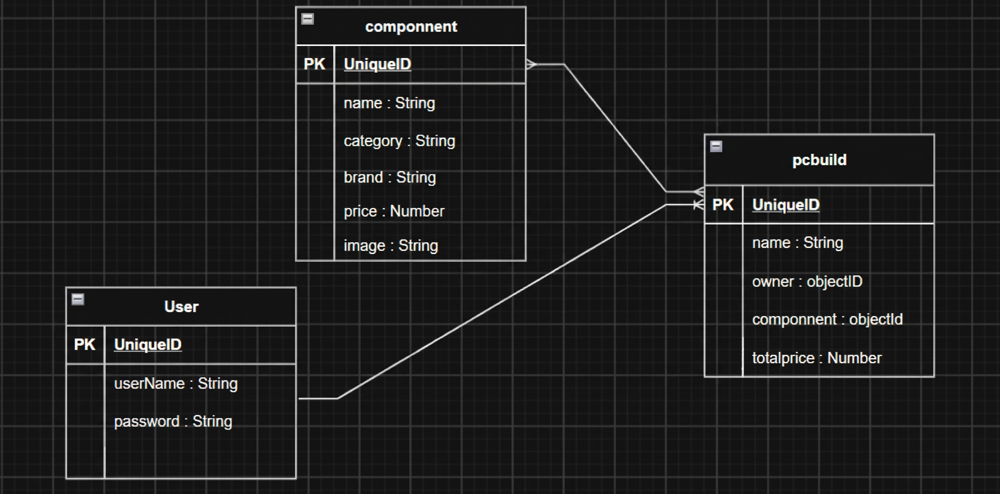

pc-builder - project2

Overview

 pc-builder is a web application that allows users to create and manage their own custom PC builds.

Users can select different computer components, including CPUs, GPUs, RAM, motherboards, storage, power supplies, and cases.

The application allows registered users to create, view, edit, and delete their PC builds. Users can also view the estimated total price of their selected components.

Screenshots

Home Page

Sign In Page

sign up page

Create PC Build

My Builds

Edit PC Build

Technologies Used
* HTML
* CSS
* JavaScript
* EJS
* Node.js
* Express.js
* MongoDB
* Mongoose
* bcrypt
* Express Session
* Method Override
* Git
* GitHub

Getting Started

1. Clone the repository:

git clone YOUR_REPOSITORY_URL

2. Navigate to the project folder:

cd project2

3. Install the dependencies:

npm install

4. Create a .env file and add the required MongoDB connection and session configuration variables.
5. Start the application:

npm run dev

6. Open the application in your browser using the port configured in your server.
7. Create an account or sign in to start building your PC.

User Stories

1. As a visitor, I want to register an account so that I can create my own PC builds.
2. As a user, I want to log in and log out so that I can securely access my account.
3. As a user, I want to browse available PC components so that I can choose parts for my build.
4. As a user, I want to create a custom PC build so that I can save my selected components.
5. As a user, I want to view the total price of my PC build so that I can manage my budget.
6. As a user, I want to view all my saved PC builds so that I can review them.
7. As a user, I want to edit my PC build so that I can change its components.
8. As a user, I want to delete a PC build so that I can remove unwanted builds.

Database Design

The application uses three main MongoDB models:

User

* Stores user account information.
* Each user can create multiple PC builds.

Componnent

* Stores available PC components.
* Each component has a name, category, brand, and price.
* Components can be selected for different PC builds.

PcBuild

* Stores the PC build name.
* Stores the owner of the build.
* Stores the selected components.
* Stores the estimated total price.

Relationships

* One User can have many PC Builds.
* Each PC Build belongs to one User.
* Each PC Build can contain multiple Components.
* Each Component can be used in multiple PC Builds.

Routes
| Method | Route | Description |
| --- | --- | --- |
| **GET** | `/` | Display home page |
| **GET** | `/auth/sign-up` | Display sign-up form |
| **POST** | `/auth/sign-up` | Register a new user |
| **GET** | `/auth/sign-in` | Display sign-in form |
| **POST** | `/auth/sign-in` | Log in |
| **GET** | `/auth/sign-out` | Log out |
| **GET** | `/components` | Display Create PC Build form |
| **POST** | `/pc-builds` | Create and save a new PC build |
| **GET** | `/pc-builds` | View all saved PC builds |
| **GET** | `/pc-builds/:buildid/edit` | Display edit PC build form |
| **PUT** | `/pc-builds/:buildid` | Update an existing PC build |
| **DELETE** | `/pc-builds/:buildid` | Delete a PC build |

Features
* User registration and authentication.
* Secure login and logout.
* Browse available PC components.
* Select CPU, GPU, RAM, motherboard, storage, power supply, and case.
* Create and save custom PC builds.
* View the estimated total price.
* View saved PC builds.
* Edit PC build names and components.
* Delete unwanted PC builds.
* Protected routes for registered users.
* Users can manage their own PC builds.
* photo for each component

Future Enhancements

* Add compatibility checking between selected components.
* Add more component brands and models.
* Allow users to compare different PC builds.
* Add filtering options based on price and brand.
* Improve the website design and user experience.